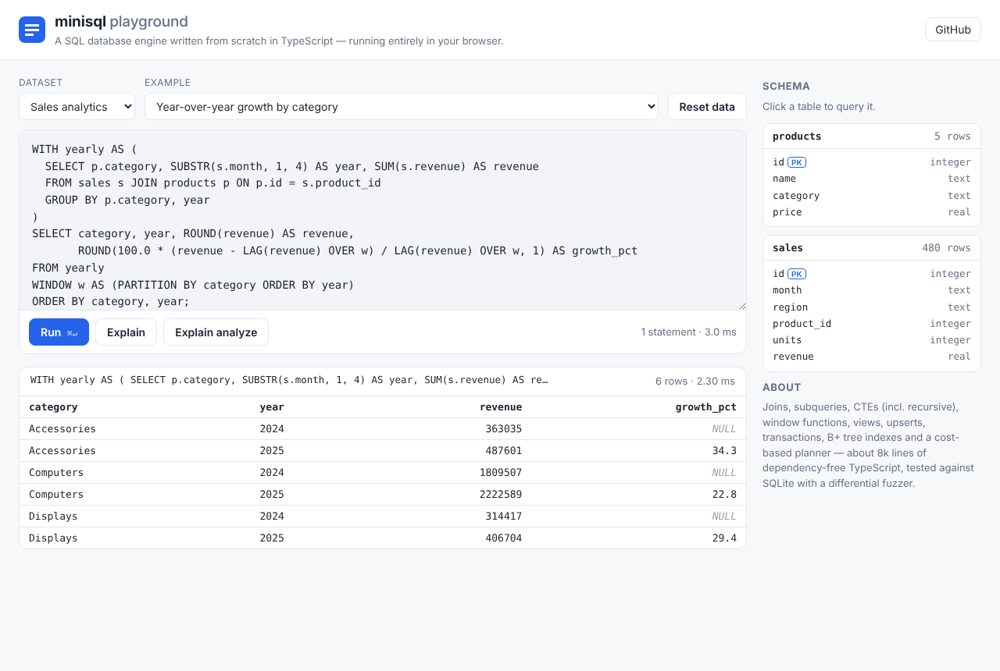
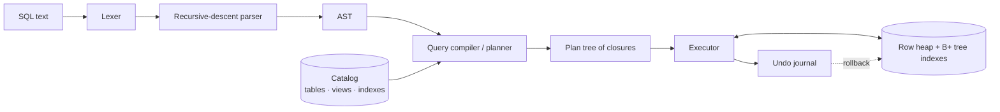

# minisql

**A relational SQL database engine written from scratch in TypeScript — with zero runtime dependencies.**

minisql parses SQL, plans queries with a small cost-based optimizer, executes them over B+ tree indexes, and
enforces constraints inside transactions. It is tested against SQLite with a differential fuzzer: hundreds of
thousands of randomly generated queries and data-modifying statements must produce exactly the same results
in both engines.

```
$ node dist/cli.js shop.json
minisql 0.1.0. Type .help for commands; end SQL statements with ';'.
minisql> SELECT c.name, COUNT(*) AS orders, SUM(o.total) AS spent,
   ...>        RANK() OVER (ORDER BY SUM(o.total) DESC) AS rank
   ...> FROM customers c JOIN orders o ON o.customer_id = c.id
   ...> GROUP BY c.name ORDER BY rank;
┌───────┬────────┬───────┬──────┐
│ name  │ orders │ spent │ rank │
├───────┼────────┼───────┼──────┤
│ Grace │      2 │ 399.9 │    1 │
│ Ada   │      2 │ 200.5 │    2 │
│ Linus │      1 │    42 │    3 │
└───────┴────────┴───────┴──────┘
3 rows
minisql> EXPLAIN SELECT c.name, SUM(o.total) FROM customers c
   ...> JOIN orders o ON o.customer_id = c.id WHERE c.country = 'US' GROUP BY c.name;
PROJECT name, SUM(o.total)
└─ GROUP BY c.name [SUM(o.total)]
   └─ INNER JOIN (index nested loop) ON o.customer_id = c.id
      ├─ SCAN customers AS c WHERE c.country = 'US'
      └─ SEARCH orders AS o USING INDEX idx_orders_customer (customer_id=?)
```



## 목적과 활용 방법 (한국어 안내)

### 이 프로젝트는 무엇을 위한 것인가요?

minisql은 **외부 라이브러리 없이 TypeScript만으로 처음부터 만든 관계형 SQL 데이터베이스 엔진**입니다.
SQLite 같은 데이터베이스가 내부에서 어떻게 동작하는지(파싱 → 실행 계획 → 인덱스 → 트랜잭션)를
직접 구현해 보여 주는 것이 목적이며, 동시에 실제로 쓸 수 있는 가벼운 임베디드 DB이기도 합니다.

### 무엇을 할 수 있나요?

| 용도 | 설명 |
| --- | --- |
| **데이터베이스 내부 학습** | 렉서, 파서, 쿼리 플래너, B+ 트리 인덱스, 해시 조인, Undo 저널 기반 트랜잭션 등을 읽기 쉬운 코드(약 8천 줄)로 공부할 수 있습니다. `EXPLAIN ANALYZE`로 플래너가 어떤 결정을 내렸는지 바로 확인할 수 있습니다. |
| **SQL 연습 / 교육** | 브라우저 플레이그라운드에서 설치 없이 조인, 서브쿼리, 재귀 CTE, 윈도 함수를 실습할 수 있습니다. 강의·스터디 자료로 쓰기 좋습니다. |
| **가벼운 임베디드 DB** | Node.js 앱, CLI 도구, 테스트 코드 안에서 메모리 DB로 사용하고, 필요하면 `.json` / `.sql` 파일로 저장할 수 있습니다. 네이티브 빌드가 필요 없습니다. |
| **JSON 문서 처리** | JSON 텍스트 컬럼을 `->>`, `json_extract`로 조회하고 `json_object`, `json_group_array`로 결과를 JSON으로 만들 수 있습니다. |
| **브라우저 안의 SQL** | 런타임 의존성이 없어 프런트엔드에서도 그대로 동작합니다. 대시보드나 데모 페이지에서 클라이언트 측 데이터 분석에 활용할 수 있습니다. |
| **테스트용 가짜 DB** | 단위 테스트에서 실제 DB 서버 대신 빠르게 띄우고 버리는 SQL 저장소로 쓸 수 있습니다. |
| **포트폴리오 / 참고 구현** | SQLite와의 차분 퍼징(differential fuzzing), 벤치마크, CI까지 갖춘 엔지니어링 사례로 참고할 수 있습니다. |

### 어떻게 사용하나요?

**1. 설치 및 빌드**

```sh
git clone https://github.com/otter04/product-buildup-first-test.git minisql
cd minisql
npm install
npm run build
```

**2. 대화형 셸(CLI)로 사용하기**

```sh
node dist/cli.js                 # 메모리 DB로 시작
node dist/cli.js mydata.json     # 파일 DB (변경 사항이 자동 저장됨)
node dist/cli.js -e "SELECT 1 + 1;"          # 한 줄 실행
node dist/cli.js -m csv < report.sql > out.csv   # 스크립트 실행 후 CSV로 출력
```

셸 안에서는 `.tables`, `.schema`, `.dump`, `.mode csv`, `.timer on`, `.help` 같은 명령을 쓸 수 있습니다.

**3. 코드에서 라이브러리로 사용하기**

```ts
import { Database } from "minisql";

const db = new Database();
db.exec("CREATE TABLE users (id INTEGER PRIMARY KEY, name TEXT NOT NULL)");
db.run("INSERT INTO users (name) VALUES (?)", ["홍길동"]);
console.log(db.query("SELECT * FROM users")); // [{ id: 1, name: "홍길동" }]

// 같은 쿼리를 반복 실행할 때는 prepare()로 계획을 재사용
const find = db.prepare("SELECT name FROM users WHERE id = ?");
find.get([1]); // { name: "홍길동" }

// 트랜잭션: 예외가 나면 전부 롤백
db.transaction((tx) => {
  tx.run("INSERT INTO users (name) VALUES (?)", ["김철수"]);
});
```

파일 저장이 필요하면 `minisql/node`의 `openDatabase` / `saveDatabase`를 사용합니다.

**4. 브라우저 플레이그라운드**

```sh
npm run site
python3 -m http.server -d site   # http://localhost:8000 접속
```

GitHub의 *Settings → Pages → Source: GitHub Actions*를 켜 두면 `main`에 push할 때마다 자동으로 배포됩니다.

**5. 그 밖의 명령**

```sh
npm test           # 전체 테스트
npm run fuzz       # SQLite와 결과를 비교하는 차분 퍼징 (Node 22 이상)
npm run bench      # SQLite 대비 성능 벤치마크
npm run examples   # examples/ 폴더의 예제 실행
```

### 한계

모든 데이터는 메모리에 있고 파일 저장은 스냅샷 방식이라, 대용량 데이터나 여러 프로세스가 동시에 쓰는
운영 환경용 DB를 대신하지는 않습니다. 학습, 도구, 테스트, 소규모 데이터에 알맞습니다.
SQLite와의 차이는 아래 [Differences from SQLite](#differences-from-sqlite)를 참고하세요.

## Contents

- [목적과 활용 방법 (한국어 안내)](#목적과-활용-방법-한국어-안내)
- [Features](#features)
- [Browser playground](#browser-playground)
- [Getting started](#getting-started)
- [Library API](#library-api)
- [Command-line shell](#command-line-shell)
- [SQL reference](#sql-reference)
- [How it works](#how-it-works)
- [Testing](#testing)
- [Performance](#performance)
- [Differences from SQLite](#differences-from-sqlite)
- [Project layout](#project-layout)

## Features

| Area | What is supported |
| --- | --- |
| **Queries** | `SELECT` with `DISTINCT`, expressions, aliases, `WHERE`, `GROUP BY`, `HAVING`, `ORDER BY … NULLS FIRST/LAST`, `LIMIT`/`OFFSET` |
| **Joins** | `INNER`, `LEFT`, `RIGHT`, `FULL OUTER`, `CROSS`, comma joins, `USING`, self joins, derived tables |
| **Expressions** | arithmetic, `CASE`, `CAST`, `IN`, `BETWEEN`, `LIKE … ESCAPE`, `GLOB`, `IS [NOT] DISTINCT FROM`, result-column aliases in `ORDER BY` / `HAVING` |
| **Subqueries** | scalar, `IN`, `EXISTS`, correlated at any depth, in `SELECT`, `WHERE`, `HAVING`, `SET` and `RETURNING` |
| **Set operations** | `UNION`, `UNION ALL`, `INTERSECT`, `EXCEPT`, standalone `VALUES` |
| **CTEs** | `WITH`, `WITH RECURSIVE` (with cycle-safe `UNION` and a runaway-recursion guard) |
| **Window functions** | `ROW_NUMBER`, `RANK`, `DENSE_RANK`, `PERCENT_RANK`, `CUME_DIST`, `NTILE`, `LAG`, `LEAD`, `FIRST_VALUE`, `LAST_VALUE`, `NTH_VALUE`, and every aggregate with `OVER (PARTITION BY … ORDER BY … ROWS/RANGE BETWEEN …)`; named windows (`WINDOW w AS …`) |
| **JSON** | `json_extract`, `json_object`, `json_array`, `json_set` / `insert` / `replace` / `remove`, `json_patch`, `json_type`, `json_valid`, `json_array_length`, `->` and `->>`, `json_group_array` / `json_group_object` — checked against SQLite's JSON1 |
| **Aggregates** | `COUNT`, `SUM`, `TOTAL`, `AVG`, `MIN`, `MAX`, `GROUP_CONCAT`/`STRING_AGG`, `BOOL_AND`/`BOOL_OR`, `VARIANCE`, `STDDEV`, `MEDIAN`, plus `DISTINCT` |
| **Writes** | `INSERT … VALUES / SELECT / DEFAULT VALUES`, `UPDATE`, `DELETE`, upserts (`ON CONFLICT … DO NOTHING / DO UPDATE`), `INSERT OR IGNORE / OR REPLACE`, `REPLACE INTO`, `RETURNING` |
| **Schema** | `CREATE/DROP TABLE`, `CREATE TABLE … AS SELECT`, `ALTER TABLE` (add / drop / rename column, rename table), `CREATE [UNIQUE] INDEX`, `CREATE VIEW` |
| **Constraints** | `PRIMARY KEY` (incl. composite), `AUTOINCREMENT`, `UNIQUE`, `NOT NULL`, `CHECK`, `DEFAULT`, `FOREIGN KEY … REFERENCES` |
| **Types** | `INTEGER`, `REAL`, `TEXT`, `BOOLEAN` and untyped columns, with SQL three-valued logic and `CAST` |
| **Transactions** | `BEGIN` / `COMMIT` / `ROLLBACK` (data *and* schema changes), statement-level atomicity, `db.transaction(fn)` |
| **Optimizer** | index selection (equality, ranges, `IN`, `BETWEEN`, composite prefixes), predicate push-down, join strategy choice, `ORDER BY … LIMIT` served from indexes, shared aggregate evaluation, plan caching |
| **Introspection** | `EXPLAIN`, `EXPLAIN ANALYZE` (rows and loops per plan node), `SHOW TABLES`, `DESCRIBE`, `db.schema()` |
| **Functions** | 70+ built-ins: string, math, date/time (`DATE`, `DATETIME`, `STRFTIME`, modifiers like `'+1 month'`), conditional (`COALESCE`, `IIF`, `NULLIF`, `CASE`), `PRINTF`, `LIKE … ESCAPE`, `GLOB` |
| **Persistence** | JSON snapshots, SQL dumps, atomic file saves |
| **Tooling** | interactive shell with multi-line input, table / CSV / JSON / line output, East-Asian-width aware tables; a browser playground |

## Browser playground

[`site/`](site/) is a static web page that runs the engine in the browser: pick a sample database (a company
org chart, two years of sales data generated by a recursive CTE, or a flight-route graph), run the example
queries or your own, and inspect plans with **Explain** / **Explain analyze**.

```sh
npm run site                     # build and copy the engine into site/lib
python3 -m http.server -d site   # then open http://localhost:8000
```

The [`pages` workflow](.github/workflows/pages.yml) publishes it to GitHub Pages on every push to `main`
(enable it once under *Settings → Pages → Source: GitHub Actions*).

## Getting started

Requires Node.js 20 or newer (Node 22+ also runs the SQLite differential tests).

```sh
git clone https://github.com/otter04/product-buildup-first-test.git minisql
cd minisql
npm install
npm run build

node dist/cli.js            # interactive shell on an in-memory database
node dist/cli.js shop.json  # ...or on a file that is saved after every change
npm test                    # run the test suite
npm run examples            # run the examples in ./examples
npm run bench               # benchmark (compares against SQLite when available)
npm run site                # build the browser playground
```

## Library API

```ts
import { Database } from "minisql";

const db = new Database();

db.exec(`
  CREATE TABLE users (
    id    INTEGER PRIMARY KEY,
    email TEXT NOT NULL UNIQUE,
    name  TEXT,
    karma INTEGER DEFAULT 0 CHECK (karma >= 0)
  )
`);

// run(): data-modifying statements
const { changes, lastInsertRowId } = db.run("INSERT INTO users (email, name) VALUES (?, ?)", ["ada@example.com", "Ada"]);

// query() / get(): rows as objects
db.query("SELECT * FROM users WHERE karma >= :min", { min: 0 }); // [{ id: 1, email: "ada@example.com", name: "Ada", karma: 0 }]
db.get("SELECT COUNT(*) AS n FROM users"); // { n: 1 }

// exec(): every statement of a script, as { columns, rows, changes, lastInsertRowId } results
const [result] = db.exec("SELECT id, name FROM users");
result.columns; // ["id", "name"]
result.rows; // [[1, "Ada"]]

// prepare(): parse and plan once, run many times
const upsertKarma = db.prepare(`
  INSERT INTO users (email, karma) VALUES (?, ?)
  ON CONFLICT (email) DO UPDATE SET karma = users.karma + excluded.karma
  RETURNING karma
`);
upsertKarma.get(["ada@example.com", 5]); // { karma: 5 }

// transaction(): commit on return, roll back on throw
db.transaction((tx) => {
  tx.run("UPDATE users SET karma = karma - 10 WHERE id = 1"); // violates CHECK -> throws
}); // the whole transaction is rolled back
```

| Method | Description |
| --- | --- |
| `exec(sql, params?)` | Runs every statement in `sql`; returns a `QueryResult` per statement |
| `query(sql, params?)` | Rows of the last statement as objects |
| `get(sql, params?)` | First row of the last statement, or `undefined` |
| `run(sql, params?)` | `{ changes, lastInsertRowId }` |
| `prepare(sql)` | A `PreparedStatement` with `all`, `get`, `run`, `values`, `execute` |
| `transaction(fn)` | Runs `fn` in a transaction; nested calls join the outer one |
| `tables()`, `views()`, `columns(table)` | Catalog introspection |
| `schema()` / `dump()` | `CREATE` statements / a full SQL script that recreates the database |
| `toJSON()` / `Database.fromJSON(snapshot)` | Serializable snapshots |

Parameters can be positional (`?`) or named (`:name`, `$name`, `@name`). Values may be `number`, `string`,
`boolean`, `null`, `bigint`, `Date` or `undefined` (treated as `NULL`).

Errors are typed: `SqlSyntaxError` (with `line` and `column`), `SqlCatalogError` (unknown tables, columns,
functions), `SqlConstraintError` and `SqlRuntimeError` all extend `SqlError`.

File persistence lives in the Node-specific entry point so the core stays environment-agnostic:

```ts
import { openDatabase, saveDatabase } from "minisql/node";

const db = openDatabase("app.json"); // .json snapshot or .sql dump; a missing file gives an empty database
db.run("INSERT INTO notes (body) VALUES (?)", ["hello"]);
saveDatabase(db, "app.json"); // written atomically (temp file + rename)
```

## Command-line shell

```
minisql [file] [options]

  -e, --execute <sql>  Execute SQL and exit
  -m, --mode <mode>    Output mode: table (default), csv, json, line
  -h, --help           Show help
  -v, --version        Show version
```

When stdin is not a terminal it is executed as a script, so `minisql -m csv < report.sql > report.csv` works.
Inside the shell, statements end with `;` and can span lines. Dot-commands:

| Command | |
| --- | --- |
| `.tables` | List tables |
| `.schema [table]` | Show `CREATE` statements |
| `.describe <table>` | Show columns |
| `.dump` | Print the database as SQL |
| `.read <file>` | Execute a SQL file |
| `.save [file]` / `.open <file>` | Save to / load from a `.json` snapshot or `.sql` dump |
| `.mode table\|csv\|json\|line` | Output format |
| `.timer on\|off` | Show execution times |

## SQL reference

A few examples of what the engine understands — see the [tests](tests/) for many more.

```sql
-- Window functions with frames
SELECT month, amount,
       SUM(amount) OVER (ORDER BY month) AS running_total,
       AVG(amount) OVER (ORDER BY month ROWS BETWEEN 2 PRECEDING AND CURRENT ROW) AS moving_avg,
       amount - LAG(amount) OVER (ORDER BY month) AS change
FROM sales WHERE region = 'north';

-- Top-N per group
SELECT * FROM (
  SELECT region, month, amount, ROW_NUMBER() OVER (PARTITION BY region ORDER BY amount DESC) AS rn
  FROM sales
) ranked WHERE rn <= 3;

-- Recursive CTE: walk a tree
WITH RECURSIVE path(id, name, depth) AS (
  SELECT id, name, 0 FROM categories WHERE parent_id IS NULL
  UNION ALL
  SELECT c.id, p.name || ' / ' || c.name, p.depth + 1
  FROM categories c JOIN path p ON c.parent_id = p.id
)
SELECT name, depth FROM path ORDER BY name;

-- Correlated subqueries
SELECT name FROM employees e
WHERE salary > (SELECT AVG(salary) FROM employees x WHERE x.dept_id = e.dept_id);

-- Upsert with RETURNING
INSERT INTO inventory (sku, qty) VALUES ('A-1', 5)
ON CONFLICT (sku) DO UPDATE SET qty = inventory.qty + excluded.qty
RETURNING sku, qty;

-- Dates
SELECT DATE('2024-01-31', '+1 month'), STRFTIME('%Y-W%W', 'now'), DATETIME('now', 'start of day');

-- See what the planner did, with row counts per node
EXPLAIN ANALYZE
SELECT d.name, COUNT(*) FROM departments d JOIN employees e ON e.dept_id = d.id
WHERE d.budget > 100000 GROUP BY d.name ORDER BY 2 DESC LIMIT 2;
```

```
LIMIT 2 (rows=2)
└─ SORT BY 2 DESC (rows=2)
   └─ PROJECT name, COUNT(*) (rows=3)
      └─ GROUP BY d.name [COUNT(*)] (rows=3)
         └─ INNER JOIN (index nested loop) ON e.dept_id = d.id (rows=6)
            ├─ SCAN departments AS d WHERE d.budget > 100000 (rows=3)
            └─ SEARCH employees AS e USING INDEX idx_dept (dept_id=?) (rows=6 loops=3)
Execution: 2 rows in 0.412 ms
```

**Type system.** Columns declared `INTEGER`, `REAL`, `TEXT` or `BOOLEAN` coerce values on write and reject
values that cannot be represented (`'abc'` into an `INTEGER` column is an error; `'42'` becomes `42`). Columns
without a type accept anything. Common aliases (`INT`, `VARCHAR(n)`, `DOUBLE`, `BOOL`, `DATETIME`, …) are mapped
to these four. Comparisons follow SQL three-valued logic, and numeric strings compare equal to numbers
(`'10' = 10`).

**Primary keys.** A table whose primary key is a single `INTEGER` column is *clustered* on it, like SQLite's
rowid tables: rows are stored and scanned in key order, and `NULL` keys are assigned automatically
(`max + 1`, or never-reused values with `AUTOINCREMENT`).

## How it works



1. **Lexer** (`src/lexer.ts`) turns text into tokens with line/column positions; it understands quoted
   identifiers (`"x"`, `` `x` ``, `[x]`), escaped strings, numeric formats, comments and four parameter styles.
2. **Parser** (`src/parser.ts`) is a hand-written recursive-descent parser with precedence climbing for
   expressions. It desugars some syntax (`USING`, `IS [NOT] DISTINCT`-style `IS`, `VALUES` tables) into
   simpler AST nodes. Keywords that are commonly used as names (`key`, `first`, `rows`, …) stay usable as identifiers.
3. **Compiler and planner** (`src/compiler.ts`, `src/planner.ts`) turn the AST into a tree of JavaScript
   closures. Column references are resolved once at compile time into `(depth, index)` pairs, so evaluating
   a correlated subquery just walks up a chain of row environments.
   - `WHERE` and `ON` predicates are split into conjuncts and **pushed down** to the table they reference, or
     attached to the lowest join that covers them, taking care never to move a predicate across the
     null-supplying side of an outer join.
   - For each table scan the planner scores every index against the pushed-down predicates
     (equality prefixes, then a range on the next column, `IN` lists, `BETWEEN`) and picks the best
     **access path**. Probe values are converted to the column's storage type, falling back to a full scan
     whenever an index lookup could miss rows that SQL comparison semantics would match.
   - **Joins** use an *index nested loop* when the inner side is a table with an index on the join key, a
     *hash join* for other equi-joins (hashing values so that `10` and `'10'` collide, then re-checking), and a
     *nested loop* otherwise. `RIGHT` and `FULL` joins track unmatched build-side rows.
   - When `ORDER BY` lists plain columns of a single table, the planner looks for an index (or the clustered
     primary key) that already yields that order — walking it backwards for `DESC` — and drops the sort, so
     `ORDER BY id DESC LIMIT 10` reads ten rows instead of sorting the table.
   - Uncorrelated subqueries and CTEs are evaluated once per execution; correlation is detected
     automatically during name resolution.
   - Aggregation is hash-based; window functions sort each partition once and compute frames incrementally
     where possible.
4. **Plan cache.** Parameters are read at run time, so compiled plans are reusable. Prepared statements and
   recently executed SQL (an LRU keyed by SQL text) keep their plans until the catalog's schema version
   changes — including when a schema change is rolled back.
5. **Storage** (`src/storage.ts`, `src/btree.ts`) keeps rows in a heap keyed by row id, plus one
   [B+ tree](src/btree.ts) per index with doubly linked leaves for range scans in both directions. Index keys
   are `(column values…, row id)`, which makes every key unique and gives deterministic tie ordering.
6. **Transactions** use an **undo journal**: every mutation — row inserts, updates and deletes, but also
   index creation, `ALTER TABLE`, view and table drops — records a closure that reverts it. Each statement
   remembers the journal position it started at, so a failing statement is undone on its own, and `ROLLBACK`
   unwinds the whole transaction.

## Testing

```sh
npm test            # 360+ tests
npm run typecheck
```

Besides unit tests for every layer (lexer, parser, B+ tree, expressions, joins, aggregates, windows, DML,
DDL, transactions, persistence, the CLI), the suite contains a **differential fuzzer**
([`tests/differential.test.ts`](tests/differential.test.ts)) that runs on Node 22+ via the built-in
`node:sqlite` module:

- It generates random tables with random data (including `NULL`s), then random queries: joins of every
  kind (up to three tables), derived tables and CTEs, correlated `EXISTS` / `IN` / scalar subqueries, set
  operations, aggregates with `HAVING`, `DISTINCT`, `CASE`, string functions, and window functions with
  `ROWS` / `RANGE` frames.
- Each query runs on SQLite and on two minisql databases — one with secondary indexes, one without — and all
  three results must match. This checks query semantics *and* that every index access path returns exactly
  what a full scan would.
- A second fuzzer applies random `INSERT` / `UPDATE` / `DELETE` / upsert / `INSERT OR REPLACE` statements
  with `RETURNING` and compares the returned rows and the full table contents after every batch.

`FUZZ_SEEDS=500 npm run fuzz` runs a longer campaign; CI runs 200 seeds of each fuzzer on every push.

The default run covers a few thousand queries; while developing, the fuzzer was run with thousands of seeds
(well over half a million statements) with no disagreements. Bugs it caught along the way included scan-order
differences for rowid-aliased primary keys and index tie-breaking — both now match SQLite.

## Performance

`npm run bench` runs a set of workloads on 50,000 orders / 5,000 customers and, when `node:sqlite` is
available, runs the same workloads on SQLite (native C) for reference. Median of five runs on Node 22:

| workload | minisql | SQLite | ratio |
| --- | ---: | ---: | ---: |
| bulk insert (55,000 rows, one transaction) | 254 ms | 63 ms | 4.0× |
| 20,000 point lookups by primary key | 62 ms | 27 ms | 2.3× |
| 20 filtered full scans | 161 ms | 67 ms | 2.4× |
| 200 secondary-index range scans | 107 ms | 60 ms | 1.8× |
| join + group by (index nested loop) | 57 ms | 25 ms | 2.3× |
| join on unindexed columns (hash join) | 146 ms | 93 ms | 1.6× |
| group by + order by | 33 ms | 18 ms | 1.8× |
| window function (running total) | 119 ms | 85 ms | 1.4× |
| sort 50,000 rows | 65 ms | 40 ms | 1.6× |
| 1,000 × top-10 by key (`ORDER BY … LIMIT`) | 6.7 ms | 5.1 ms | 1.3× |
| correlated subquery | 61 ms | 17 ms | 3.6× |
| update 10% of rows | 12 ms | 4 ms | 3.0× |

Numbers vary from machine to machine; the ratios are the interesting part.

Being within a small factor of SQLite comes from a handful of decisions: compiling expressions to closures
instead of interpreting the AST, caching plans, iterating B+ tree leaves in batches, reusing row
environments in hot loops, serving `ORDER BY … LIMIT` from indexes (before that optimization the top-10
workload took 24 seconds), and only touching the indexes whose keys an `UPDATE` actually changes.

## Differences from SQLite

minisql follows SQLite's behavior closely (that is what the fuzzer checks), with these deliberate differences:

- `/` is always true division (`7 / 2 = 3.5`), because all numbers are JavaScript doubles.
- Columns have strict declared types instead of SQLite's type affinity, and booleans are a real type.
- Foreign keys are always enforced (`RESTRICT` semantics); there is no `PRAGMA`.
- Everything lives in memory; persistence is by snapshot (`.json`) or dump (`.sql`), not page-level I/O.
- Not implemented: triggers, `ALTER TABLE` on views, `GROUPS` frames, collations, `UPDATE … FROM`, blobs.

## Project layout

```
src/
  lexer.ts        tokenizer
  parser.ts       recursive-descent parser → AST (ast.ts)
  compiler.ts     name resolution and expression compilation
  planner.ts      FROM-clause planning, access paths, joins, aggregation, CTEs, EXPLAIN
  window.ts       window function evaluation
  functions.ts    scalar and aggregate functions, LIKE / GLOB
  json.ts         JSON parser, paths and edits
  jsonsql.ts      JSON functions and the -> / ->> operators
  values.ts       value semantics: comparison, coercion, casting
  btree.ts        B+ tree
  storage.ts      tables, indexes, catalog, undo journal
  database.ts     public API, DDL / DML execution, plan cache, dumps and snapshots
  persistence.ts  file I/O (minisql/node)
  format.ts       table / CSV / JSON rendering
  cli.ts          interactive shell
tests/            unit, integration and differential tests
examples/         runnable examples (quick start, analytics, a to-do app)
bench/            benchmarks
site/             browser playground (static; deployed to GitHub Pages)
```

## License

[MIT](LICENSE)
